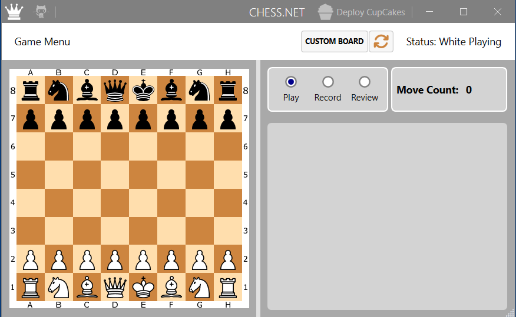

## ToDo

1. The following info needs to be added at an appropriate position in the docs, later when we begin to add chess pieces.


↔️ Ranks (Rows)

• What they are: Ranks are the horizontal rows on the chessboard, running from left to right.
• How they are labeled: There are eight ranks, numbered 1 through 8.
• The setup: White's major pieces start on rank 1 and White's pawns start on rank 2. Black's pawns start on rank 7 and Black's major pieces start on rank 8.

↕️ Files (Columns)

• What they are: Files are the vertical columns on the chessboard, running up and down between the two players.
• How they are labeled: There are eight files, lettered a through h (from left to right from White's perspective).
• Key examples: The "e-file" is the column where the Kings start, and the "d-file" is where the Queens start.



1. In the context of RowColumnLabelViewModel the following is some explanation.

In your code, Factory is the name of a custom delegate type that you have declared inside your record. Here 'Factory' is not a keyword in C#.

Here is a breakdown of what this line means:
• public delegate: These are the actual C# keywords. They tell the compiler that you are defining a blueprint for a method pointer (a delegate).
• RowColumnLabelViewModel: This is the return type. It means any method matching this delegate must return an instance of your record.
• Factory: This is simply the identifier (the name) you chose for this delegate type. You could rename it to CreateLabel, Generator, or anything else, and it would work the same way.
• (int Index, string Label): This is the parameter list. Any method matching this delegate must accept an int and a string.

Why is it written this way?

As your code's <remarks> comment suggests, this is a pattern specifically used for Dependency Injection containers like Autofac.
Instead of manually creating a factory class to instantiate your RowColumnLabelViewModel, Autofac looks at this delegate name, matches the parameter names (Index and Label), and automatically generates the factory implementation for you behind the scenes.

Autofac creates the implementation for your Factory delegate using a feature called Delegate Factories (specifically, strongly-typed delegate factories).
Instead of using reflection at runtime every time you call the factory, Autofac dynamically generates a lightweight, compiled method behind the scenes that resolves your object from the container.
Here is exactly how Autofac handles this under the hood:

1. Registration Phase (The Setup)

When you start your application, you register your RowColumnLabelViewModel class with the Autofac container builder:


```cs
var builder = new ContainerBuilder();

builder.RegisterType<RowColumnLabelViewModel>().AsSelf();

// 1. Register the concrete type
builder.RegisterType<RowColumnLabelViewModel>();

// 2. Register the Delegate Factory feature
builder.RegisterGeneratedFactory<RowColumnLabelViewModel.Factory>(); 
// Note: In newer Autofac versions, if you use the Autofac.Extensions.DependencyInjection, 
// basic delegate factories are often implicitly handled via features like standard type scanning.
```

2. The Hook (The Interception)

When Autofac sees builder.RegisterGeneratedFactory<RowColumnLabelViewModel.Factory>(), it uses the .NET System.Reflection.Emit namespace to generate a new class in memory that implements your delegate.
Essentially, Autofac writes code similar to this behind the scenes:

```cs
// Conceptually, this is what Autofac generates in memory:
public class AutofacGeneratedFactory
{
    private readonly IComponentContext _context;

    public AutofacGeneratedFactory(IComponentContext context)
    {
        _context = context;
    }

    // This method matches your RowColumnLabelViewModel.Factory signature exactly
    public RowColumnLabelViewModel Invoke(int Index, string Label)
    {
        // It converts your method arguments into Autofac parameters
        var p1 = new NamedParameter("Index", Index);
        var p2 = new NamedParameter("Label", Label);

        // It then resolves the object from the container, passing the runtime arguments
        return _context.Resolve<RowColumnLabelViewModel>(p1, p2);
    }
}

```


3. Resolution Phase (The Magic)

When a class in your application asks for RowColumnLabelViewModel.Factory in its constructor, Autofac injects a pointer to that newly generated Invoke method.

```cs
public class BoardEdgeRenderer
{
    private readonly RowColumnLabelViewModel.Factory _labelFactory;

    // Autofac injects the generated delegate here
    public BoardEdgeRenderer(RowColumnLabelViewModel.Factory labelFactory)
    {
        _labelFactory = labelFactory;
    }

    public void CreateGrid()
    {
        // When you execute this, Autofac hits its internal Resolve pipeline,
        // maps 0 to "Index", "A" to "Label", and returns the instantiated record.
        RowColumnLabelViewModel firstLabel = _labelFactory(0, "A"); 
    }
}

```


Why parameter names matter (Binding by Name)

As your code comments highlighted, Autofac ties the delegate parameters (int Index, string Label) to the primary constructor of your record by their exact names (case-sensitive by default in some configurations, case-insensitive in others, but best practice is an exact match).
If you were to change the delegate signature to delegate RowColumnLabelViewModel Factory(int position, string text), Autofac would throw a runtime exception because it wouldn't know whether position belongs to Index or if text belongs to Label.

Note, you don't need the RegisterGeneratedFactory line because Autofac includes a built-in feature called Implicit Relationship Types.

```cs
var builder = new ContainerBuilder();

builder.RegisterType<RowColumnLabelViewModel>().AsSelf();
```

When you register a type like builder.RegisterType<RowColumnLabelViewModel>().AsSelf();, Autofac automatically recognizes certain wrappers around that type without you needing to register them explicitly. It natively understands built-in types like Func<T>, Lazy<T>, IEnumerable<T>, and custom delegate factories.
Autofac scans the constructor signatures of the classes requesting dependencies. When it sees that a class requires your custom RowColumnLabelViewModel.Factory delegate, it automatically wires it up on the fly using the following steps:

How Autofac wires it up automatically

1. The Request: A class asks for RowColumnLabelViewModel.Factory in its constructor.
2. The Discovery: Autofac looks at the delegate's signature and sees it returns a RowColumnLabelViewModel.
3. The Match: Autofac checks its registry, finds that you explicitly registered RowColumnLabelViewModel via .AsSelf(), and realizes it knows how to build that object.
4. The Generation: Autofac dynamically builds the factory method in memory, mapping the delegate arguments (Index, Label) to the parameter overrides needed to resolve your record.
Because you registered the concrete class, Autofac figures out the factory delegate for you completely behind the scenes.
Would you like to see how to write a unit test to verify that Autofac is correctly resolving this factory without running your whole application?


